<div align="center">

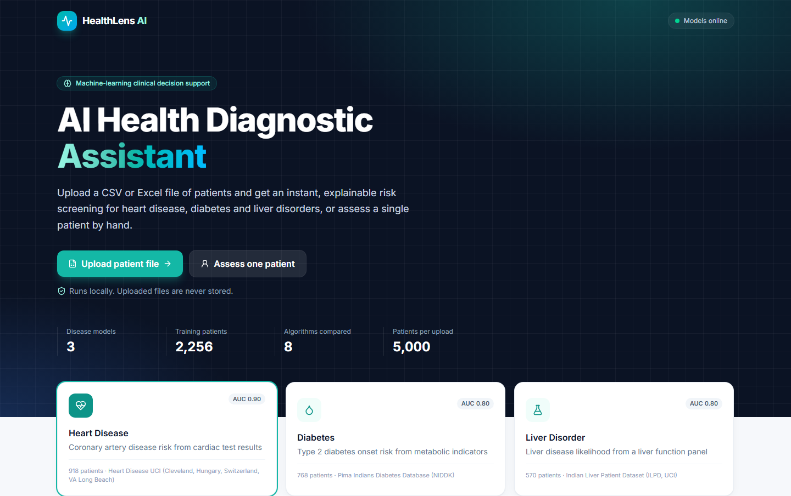

# 🩺 HealthLens AI: AI Health Diagnostic Assistant

**Upload a spreadsheet of patients → get an instant, explained risk check for
heart disease, diabetes and liver disorders.**


[What it does](#-what-is-this) ·
[Install](#-installation-step-by-step) ·
[How to use](#-how-to-use-the-app) ·
[Your own data](#-preparing-your-own-patient-file) ·
[How it works](#-how-does-the-ai-work) ·
[Help](#-troubleshooting)

<br/>

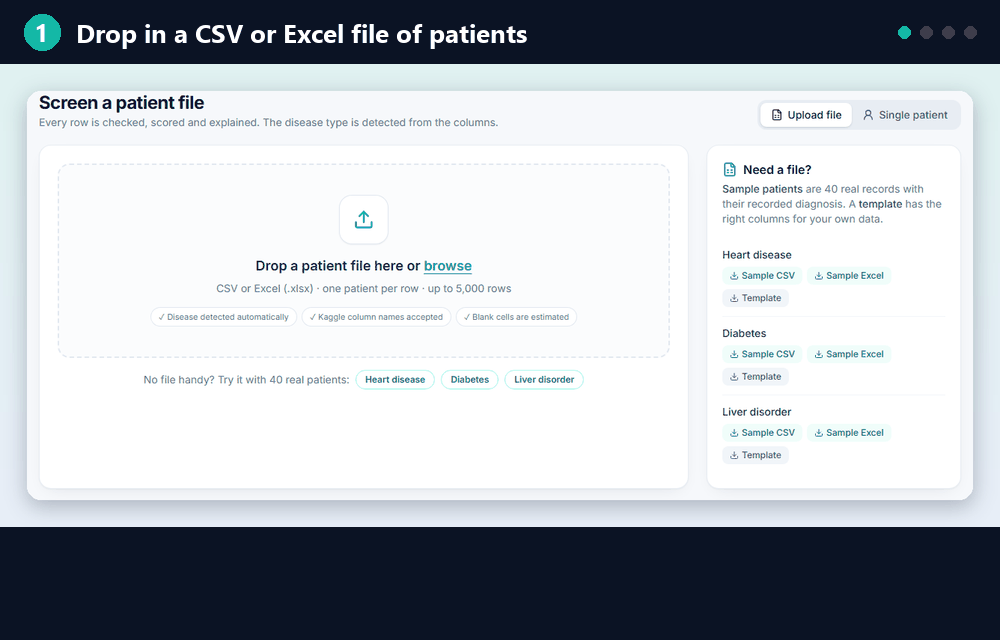

</div>

---

## 🤔 What is this?

HealthLens AI is a website that runs **on your own computer**. You give it patient health data,
such as blood pressure, blood sugar and cholesterol, and it tells you **how likely each patient is to have**:

| | Disease | What it looks at | Trained on |
|:-:|---|---|---|
| ❤️ | **Heart disease** | Chest pain, blood pressure, cholesterol, ECG and stress-test results | 918 real patients from 4 hospitals |
| 🩸 | **Diabetes** | Blood sugar, BMI, insulin, blood pressure, family history | 768 real patients |
| 🧪 | **Liver disorder** | Liver blood test (bilirubin, enzymes, proteins) | 570 real patients |

**Think of it like a junior doctor who has studied thousands of old patient files.** It has learned
which patterns usually mean "sick" and which usually mean "healthy", and it applies them to new
patients in a fraction of a second.

> **The data is real, not made up.** All three datasets are public, anonymous research datasets
> from the [UCI Machine Learning Repository](https://archive.ics.uci.edu/) (the same data that's on Kaggle).

### ✨ What you get

| | Feature | |
|:-:|---|---|
| 📂 | **Upload a CSV or Excel file** | Check up to 5,000 patients at once |
| 🔍 | **Auto-detects the disease** | It reads your column names and figures out whether it's heart, diabetes or liver data |
| 🚦 | **Clear risk levels** | Every patient gets a % score and a 🟢 Low / 🟡 Moderate / 🔴 High label |
| 💡 | **Explains *why*** | Shows the main reasons for each result, e.g. "Chest pain type: Asymptomatic" |
| ⚠️ | **Flags abnormal values** | Highlights values outside the normal medical range |
| 👤 | **Single-patient mode** | Move sliders and watch the risk change live |
| 📥 | **Download results** | Save all results as a spreadsheet |
| 📊 | **Shows its accuracy** | Charts showing how often the model is right |

---

## 💻 Installation (step by step)

You only need to do this **once**. It takes about 5 minutes.

### Step 1: Install Python

1. Go to **https://www.python.org/downloads/** and click the big yellow **Download Python** button.
2. Run the installer.
3. ⚠️ **IMPORTANT:** on the first screen, **tick the box "Add python.exe to PATH"** before clicking *Install Now*.

```
 ┌──────────────────────────────────────────────┐
 │  Install Python 3.x                           │
 │                                               │
 │   → Install Now                               │
 │   → Customize installation                    │
 │                                               │
 │  ☑ Use admin privileges when installing       │
 │  ☑ Add python.exe to PATH     ◀── TICK THIS!  │
 └──────────────────────────────────────────────┘
```

> 🍎 **Mac users:** download the macOS installer from the same page and run it.
> 🐧 **Linux users:** Python is usually already installed. Check with `python3 --version`.

### Step 2: Download this project

**Easiest way (no Git needed):**

1. Click the green **`<> Code`** button at the top of this GitHub page.
2. Click **Download ZIP**, or use this direct link: **[⬇ Download ZIP](https://github.com/samrat10000/proj-HealthLens-AI/archive/refs/heads/main.zip)**.
3. Right-click the downloaded ZIP → **Extract All…** → choose a place like your Desktop.

<details>
<summary>Or, if you know Git, click here</summary>

```bash
git clone https://github.com/samrat10000/proj-HealthLens-AI.git
cd proj-HealthLens-AI
```
</details>

### Step 3: Run the setup

| Windows 🪟 | Mac 🍎 / Linux 🐧 |
|---|---|
| Open the extracted folder and **double-click `setup.bat`** | Open **Terminal** in the project folder and run `bash setup.sh` |

A black window opens and shows four steps. **Wait until it says "Setup complete!"** (2–5 minutes):

```
=== HealthLens AI setup ===
Found Python 3.12

[1/4] Creating a private Python environment (.venv)
[2/4] Installing Python packages (takes 1-3 minutes the first time)
[3/4] Training the AI models (about 1 minute)
  Logistic Regression    AUC 0.875  ACC 0.801  F1 0.825
  Random Forest          AUC 0.872  ACC 0.812  F1 0.836
  ...
  -> selected: Soft-Voting Ensemble
[4/4] Preparing the website
Website is already built - nothing to do.

Setup complete! Now double-click start.bat (or run .\start.ps1).
```

> 💡 Windows might show a blue **"Windows protected your PC"** box. Click **More info → Run anyway**.
> This is normal for scripts downloaded from the internet.

### Step 4: Start the app

| Windows 🪟 | Mac 🍎 / Linux 🐧 |
|---|---|
| **Double-click `start.bat`** | Run `bash start.sh` |

Your browser opens **http://localhost:8000** automatically. 🎉

> ⚠️ **Keep the black window open** while you use the app. Closing it stops the app.
> Next time, you only need Step 4.

---

## 🧭 How to use the app

### Option A: Check a whole file of patients (main feature)

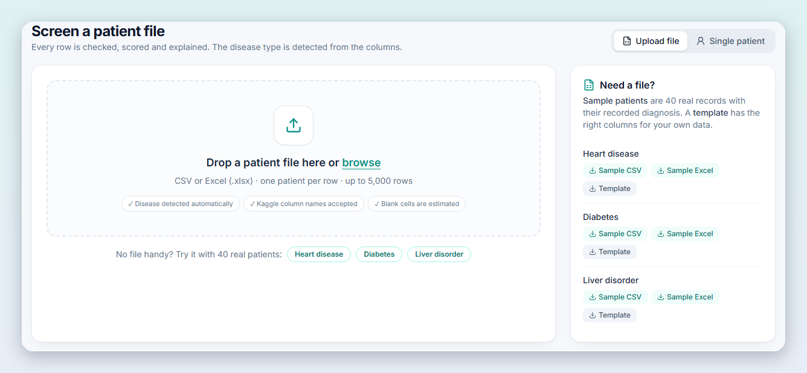

1. **Drop your CSV or Excel file** onto the big box, or click **browse** to pick it.
2. **No file yet?** Click one of the buttons under the box (**Heart disease**, **Diabetes**, **Liver disorder**)
   to try it with 40 real sample patients. You can also download sample files and blank templates on the right.
3. Wait about 1 second. The results appear:

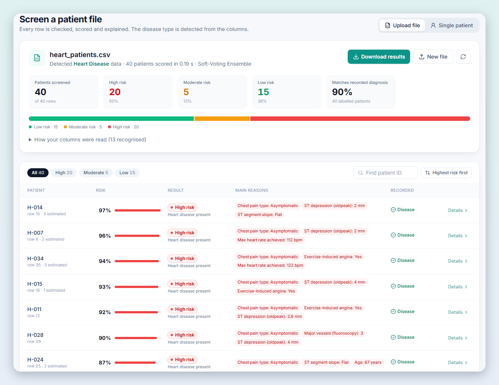

**How to read the results screen:**

| Part of the screen | What it means |
|---|---|
| **Detected *Heart Disease* data** | The app worked out which disease your file is about |
| **High / Moderate / Low risk boxes** | How many patients fall into each group |
| **Colored bar** | The same split as a picture: 🟢 low, 🟡 moderate, 🔴 high |
| **Matches recorded diagnosis** | Only shown if your file has a diagnosis column: how often the AI agreed with the real diagnosis |
| **Risk %** | The chance the patient has the disease, according to the AI |
| **Main reasons** (red tags) | The values that pushed this patient's risk **up** the most |
| **Recorded** ✓ | The real diagnosis from your file (✓ green = the AI agreed) |
| **Details ›** | Opens the full breakdown for that one patient |

**Useful buttons:** filter by **High / Moderate / Low**, search by **patient ID**, sort with
**Highest risk first**, and save everything with **Download results**.

### Option B: Check one patient by hand

Click **Single patient** at the top right, or **Details ›** on any patient in the results table.

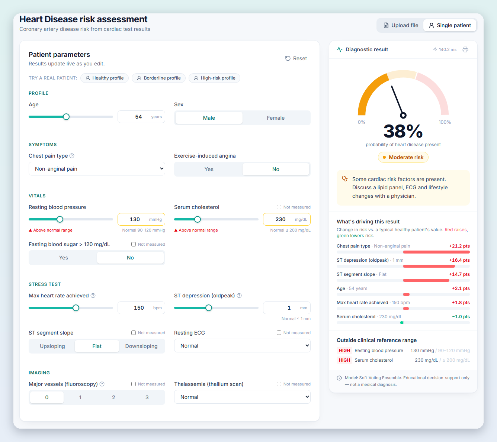

- **Left side:** move the sliders or type values. The result updates **instantly** as you change things.
- **Can't measure something?** Tick **"Not measured"** and the AI will estimate it.
- **Speedometer gauge:** the risk %. Green under 30%, yellow 30–60%, red above 60%.
- **"What's driving this result":** 🔴 red bars raise risk and 🟢 green bars lower it, compared with a typical healthy person.
- **"Outside clinical reference range":** values that are abnormal by normal medical standards.
- 🖨️ **Printer icon:** print the result or save it as a PDF.
- **"Try a real patient"** buttons load a real healthy, borderline or high-risk patient.

### 🚦 What do the risk levels mean?

| Level | Risk % | Meaning |
|:-:|:-:|---|
| 🟢 **Low** | under 30% | Looks similar to healthy patients |
| 🟡 **Moderate** | 30% – 60% | Some warning signs. Worth a closer look |
| 🔴 **High** | over 60% | Looks very similar to patients who had the disease |

---

## 📄 Preparing your own patient file

The easiest way: **download a template** from the app (right-hand panel), fill it in using Excel
or Google Sheets, save it as **.csv** or **.xlsx**, and upload it.

Ready-made files are also in the [`sample_data/`](sample_data/) folder:

| File | What's inside |
|---|---|
| `heart_patients.csv` / `.xlsx` | 40 real heart patients, with their real diagnosis |
| `diabetes_patients.csv` / `.xlsx` | 40 real diabetes patients |
| `liver_patients.csv` / `.xlsx` | 40 real liver patients |
| `*_template.csv` / `.xlsx` | Empty templates with the correct columns |

**Rules (the app is forgiving):**

- ✅ **One patient per row**, column names in the first row.
- ✅ Column names don't have to match exactly: `Glucose`, `glucose`, `Plasma glucose (mg/dL)` and Kaggle's `BloodPressure` all work.
- ✅ Words or numbers are both fine: `Male` / `M` / `1`, `Yes` / `Y` / `True`.
- ✅ Add a **Patient ID** column to see your own IDs in the results.
- ✅ Add an **Actual diagnosis** column (Yes/No) to see if the AI agrees.
- ✅ **Optional** values can be left **blank**, and the AI estimates them.
- ❌ A row with an impossible value (like glucose = 999) is skipped and **the reason is shown**. The other rows are still checked.

<details>
<summary><b>❤️ Heart disease columns</b></summary>

| Column | Unit / allowed values | Required? |
|---|---|:-:|
| Age | years (18–100) | ✅ |
| Sex | Male / Female | ✅ |
| Chest pain type | Typical angina / Atypical angina / Non-anginal pain / Asymptomatic | ✅ |
| Exercise-induced angina | Yes / No | ✅ |
| Resting blood pressure | mmHg (80–220) | ✅ |
| Max heart rate achieved | bpm (60–220) | ✅ |
| ST depression (oldpeak) | mm (-3 to 7) | ✅ |
| Serum cholesterol | mg/dL (100–600) | optional |
| Fasting blood sugar > 120 mg/dL | Yes / No | optional |
| ST segment slope | Upsloping / Flat / Downsloping | optional |
| Resting ECG | Normal / ST-T wave abnormality / Left ventricular hypertrophy | optional |
| Major vessels (fluoroscopy) | 0, 1, 2 or 3 | optional |
| Thalassemia (thallium scan) | Normal / Fixed defect / Reversible defect | optional |
</details>

<details>
<summary><b>🩸 Diabetes columns</b></summary>

| Column | Unit / allowed values | Required? |
|---|---|:-:|
| Age | years (21–90) | ✅ |
| Pregnancies | count (0–17, use 0 if not applicable) | ✅ |
| Diabetes pedigree function | family-history score (0.05–2.5) | ✅ |
| Plasma glucose (2h OGTT) | mg/dL (40–250) | ✅ |
| Body mass index | kg/m² (15–70) | ✅ |
| Diastolic blood pressure | mmHg (30–130) | ✅ |
| 2-hour serum insulin | µU/mL (10–900) | optional |
| Triceps skinfold thickness | mm (5–100) | optional |
</details>

<details>
<summary><b>🧪 Liver disorder columns</b></summary>

| Column | Unit / allowed values | Required? |
|---|---|:-:|
| Age | years (4–90) | ✅ |
| Sex | Male / Female | ✅ |
| Total bilirubin | mg/dL (0.1–75) | ✅ |
| Direct bilirubin | mg/dL (0.1–20) | ✅ |
| Alkaline phosphatase | IU/L (60–2200) | ✅ |
| ALT (SGPT) | IU/L (5–2000) | ✅ |
| AST (SGOT) | IU/L (5–5000) | ✅ |
| Total protein | g/dL (2.5–10) | ✅ |
| Albumin | g/dL (0.9–5.5) | ✅ |
| Albumin/Globulin ratio | ratio (0.3–2.8) | optional |
</details>

---

## 🧠 How does the AI work?

### The big picture

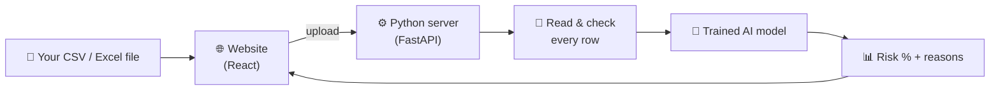

- **The website** (React) is what you see and click.
- **The Python server** (FastAPI) is the brain. It reads the file, runs the AI and sends results back.
- Everything runs **on your computer**. Uploaded files are not saved anywhere.

### How the AI was trained (in 5 simple steps)

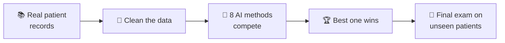

1. **📚 Collect:** download real, anonymous patient records (each one says whether the patient was sick).
2. **🧹 Clean:** old records are messy. Some say `?` where a test is missing, and some say "cholesterol = 0",
   which is impossible. These are marked as "unknown" and duplicates are removed.
3. **🏁 Compete:** 8 different AI methods (Logistic Regression, Random Forest, SVM, KNN, and more) learn
   from 80% of the patients. Each one is tested 5 times on different slices of that data (this is called *cross-validation*).
4. **🏆 Pick the winner:** the best performers are combined into a **team that votes together**
   (a *soft-voting ensemble*). The team scored highest for all three diseases.
5. **📝 Final exam:** the winner is tested on the other **20% of patients it has never seen**:

| Disease | Accuracy on unseen patients | ROC-AUC (0.5 = coin flip, 1.0 = perfect) |
|---|:-:|:-:|
| ❤️ Heart disease | **82%** | **0.90** |
| 🩸 Diabetes | **70%** | **0.80** |
| 🧪 Liver disorder | **71%** | **0.80** |

> 💬 The liver dataset is known to be hard. These scores match what published research gets on it.

### See it inside the app

Scroll down to **"Under the hood"** on any page to explore these charts yourself:

<table>
<tr>
<td width="50%"><b>🏁 Model comparison</b>: all 8 methods ranked<br/>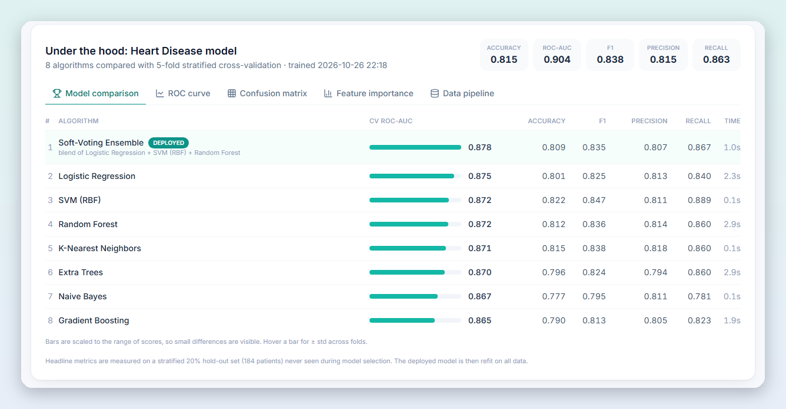</td>
<td width="50%"><b>📈 ROC curve</b>: the higher the curve, the better<br/>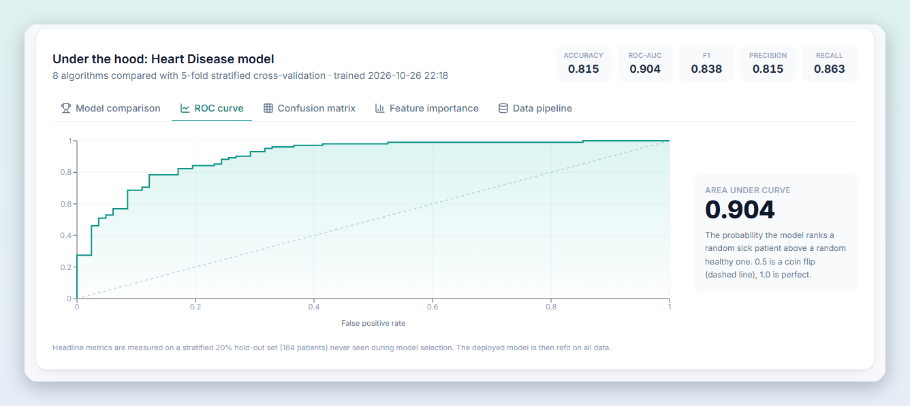</td>
</tr>
<tr>
<td><b>🎯 Confusion matrix</b>: right vs wrong answers<br/>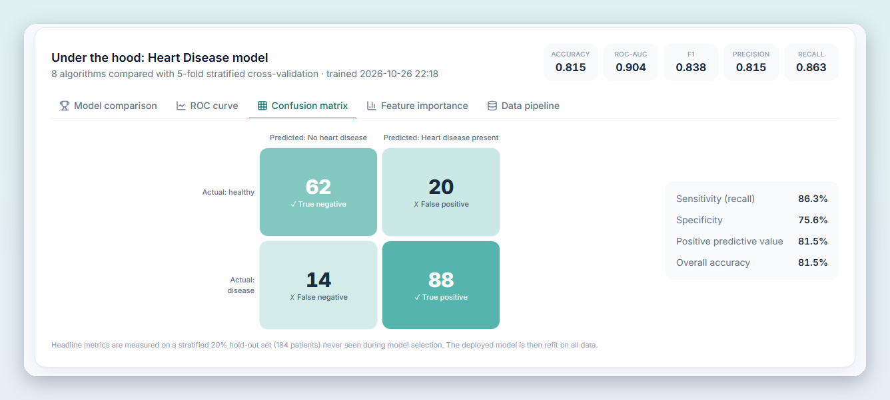</td>
<td><b>📊 Feature importance</b>: what matters most<br/>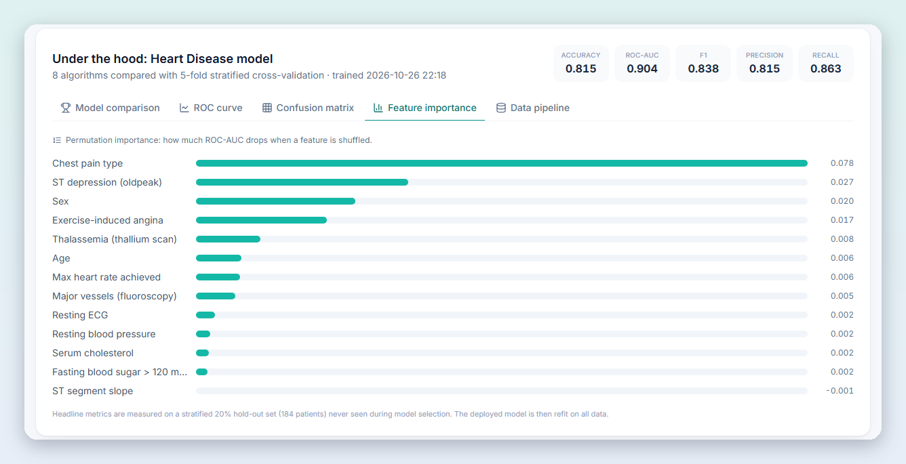</td>
</tr>
<tr>
<td colspan="2"><b>🧹 Data pipeline</b>: every cleaning step, shown in the app<br/>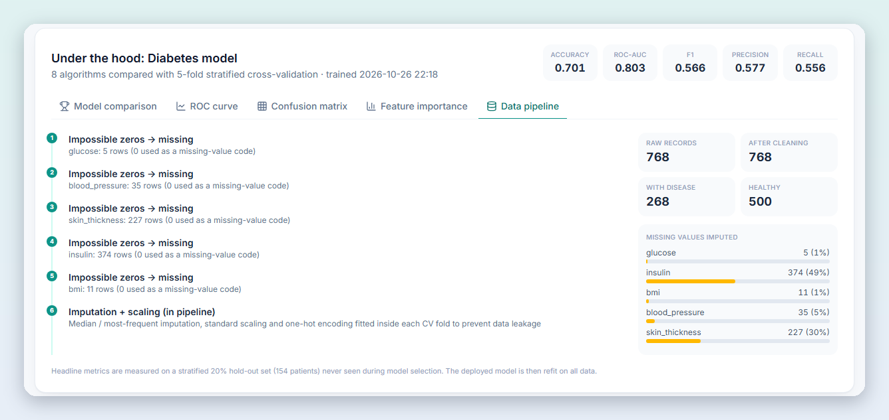</td>
</tr>
</table>

### How does it explain *why*?

For each value, the AI asks: *"If this one value were replaced by a typical healthy person's value,
how much would the risk change?"* The values that change the risk the most are shown as the **main reasons**.

---

## 🛠 Troubleshooting

<details>
<summary><b>"Python was not found" or "'python' is not recognized"</b></summary>

Python isn't installed, or the **"Add python.exe to PATH"** box wasn't ticked.
Re-run the Python installer, choose **Modify**, and make sure the PATH option is ticked. Then **restart your computer**
and run `setup.bat` again.
</details>

<details>
<summary><b>"Windows protected your PC" / "running scripts is disabled"</b></summary>

Click **More info → Run anyway**. Always use the `.bat` files (`setup.bat`, `start.bat`); they get around
the PowerShell script restriction automatically.
</details>

<details>
<summary><b>The page says "API offline" or won't load</b></summary>

The black `start.bat` window must stay open while you use the app. Start it again, wait about 5 seconds,
and refresh the browser at **http://localhost:8000**.
</details>

<details>
<summary><b>"Address already in use" / port 8000 is busy</b></summary>

Another copy of the app (or another program) is already using port 8000. Close the other black window,
or restart your computer, then run `start.bat` again.
</details>

<details>
<summary><b>Package installation failed</b></summary>

Check your internet connection and run `setup.bat` again. It continues where it stopped.
On school or office networks, a firewall may block downloads, so try a home network or mobile hotspot.
</details>

<details>
<summary><b>"Missing required column(s)" when uploading</b></summary>

Your file is missing a column the AI needs. Download the **template** from the app, copy your data into it,
and upload again. See [Preparing your own patient file](#-preparing-your-own-patient-file).
</details>

---

## 👩‍💻 For developers

<details>
<summary><b>Tech stack, project structure, API and dev mode</b></summary>

**Stack:** React 18 · TypeScript · Vite · Tailwind CSS · Recharts | FastAPI · scikit-learn · pandas

```
proj-HealthLens-AI/
├── setup.bat / setup.sh        one-time install
├── start.bat / start.sh        run the app
├── sample_data/                ready-to-upload CSV / Excel files
├── docs/images/                README screenshots
├── backend/
│   ├── ml/specs.py             feature definitions (single source of truth)
│   ├── ml/cleaning.py          data cleaning
│   ├── ml/train.py             model comparison + export
│   ├── ml/samples.py           sample / template file generator
│   ├── app/main.py             FastAPI routes (also serves the website)
│   ├── app/batch.py            CSV / Excel parsing + column matching
│   ├── app/engine.py           scoring + explanations
│   ├── data/raw/               original datasets
│   └── tests/                  pytest suite
└── frontend/
    ├── src/App.tsx             layout, live prediction loop
    ├── src/components/         BatchScreening, PatientForm, ResultPanel, RiskGauge, ModelInsights…
    └── dist/                   pre-built website (so Node.js isn't required)
```

**Dev mode with hot reload** (needs Node.js 20+):

```bash
# terminal 1
cd backend && .venv/Scripts/python -m uvicorn app.main:app --reload --port 8000   # Mac/Linux: .venv/bin/python
# terminal 2
cd frontend && npm install && npm run dev        # http://localhost:5173
```

After changing the frontend, run `npm run build` so `frontend/dist` is updated.

**API** (interactive docs at http://localhost:8000/docs)

| Method | Path | Purpose |
|---|---|---|
| GET | `/api/diseases` | List models with headline metrics |
| GET | `/api/diseases/{id}` | Feature schema + training metadata |
| POST | `/api/predict/{id}` | `{"values": {...}}` → probability, risk level, explanation, flags |
| POST | `/api/batch` | Upload CSV / Excel (multipart `file`) → every patient scored |
| GET | `/api/sample/{id}?format=csv\|xlsx` | 40 real sample patients |
| GET | `/api/template/{id}?format=csv\|xlsx` | Empty template |

**Tests:** `cd backend && .venv/Scripts/python -m pytest -q`

**Demo links:** `http://localhost:8000/?demo=heart` runs a sample upload automatically.
`?mode=single&disease=liver` opens single-patient mode.

**Note on PyCaret:** PyCaret doesn't officially support Python 3.12+, so `ml/train.py` implements the same
compare-models, blend and finalize workflow directly with scikit-learn.
</details>

---

## 📚 Datasets & credits

- **Heart Disease:** Janosi, Steinbrunn, Pfisterer & Detrano (1988). [UCI Heart Disease](https://archive.ics.uci.edu/dataset/45/heart+disease). Cleveland, Hungary, Switzerland and VA Long Beach.
- **Diabetes:** Smith et al. (1988), National Institute of Diabetes and Digestive and Kidney Diseases. [Pima Indians Diabetes Database](https://www.kaggle.com/datasets/uciml/pima-indians-diabetes-database).
- **Liver:** Ramana & Venkateswarlu (2012). [UCI Indian Liver Patient Dataset (ILPD)](https://archive.ics.uci.edu/dataset/225/ilpd+indian+liver+patient+dataset).

> **A note on the sample files:** the 40 sample patients come from the training data, so the
> "Matches recorded diagnosis" number for them (~90%) is higher than real-world accuracy.
> The honest numbers are in the [final exam table](#how-the-ai-was-trained-in-5-simple-steps) above.

---

<div align="center">

### ⚠️ Disclaimer

**HealthLens AI is an educational project. It is not a medical device and does not give a medical diagnosis.**
Always consult a qualified doctor for health decisions.

Made with ❤️ using React, FastAPI and scikit-learn

</div>
