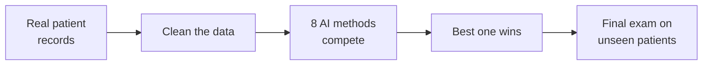

<div align="center">

#  HealthLens AI

### AI Health Diagnostic Assistant

**Upload a spreadsheet of patients → get an instant, explained risk check for
heart disease, diabetes and liver disorders.**


[Quick start](#quick-start) ·
[Install](#installation) ·
[Run](#running-the-app) ·
[How to use](#how-to-use-the-app) ·
[Your own data](#preparing-your-own-patient-file) ·
[Help](#troubleshooting)

</div>

---

## What is this?

HealthLens AI is a website that runs **on your own computer**. You give it patient health data
(blood pressure, blood sugar, cholesterol, …) and it tells you **how likely each patient is to have**:

| | Disease | What it looks at | Trained on |
|:-:|---|---|---|
|  | **Heart disease** | Chest pain, blood pressure, cholesterol, ECG and stress-test results | 918 real patients |
|  | **Diabetes** | Blood sugar, BMI, insulin, blood pressure, family history | 768 real patients |
|  | **Liver disorder** | Liver blood test (bilirubin, enzymes, proteins) | 570 real patients |

**What you get:**

-  **Upload a CSV or Excel file** and check up to 5,000 patients at once
-  **Automatic disease detection** from your column names
-  A **risk %** and a Low / Moderate / High label for every patient
-  **The reasons** behind each result, e.g. "Chest pain type: Asymptomatic"
-  **Abnormal values flagged** against normal medical ranges
-  **Single-patient mode:** move sliders and watch the risk change live
-  **Download all results** as a spreadsheet
-  **Accuracy charts** showing how well each model performs

The whole project is written in **Python**. There is no JavaScript to build and no Node.js to install.

> The data is real, public and anonymous, from the [UCI Machine Learning Repository](https://archive.ics.uci.edu/).

---

## Quick start

Already have **Python 3.10 or newer**? Open a terminal in the project folder and run:

**Windows**

```bat
setup.bat
start.bat
```

**macOS / Linux**

```bash
bash setup.sh
bash start.sh
```

Then open **http://localhost:8501** in your browser (it usually opens by itself).

New to all this? Follow the step-by-step guide below.

---

## Installation

You only do this **once**. It takes about 5 minutes.

### Step 1: Install Python

Check whether you already have it. Open a terminal and type:

| Windows (Command Prompt or PowerShell) | macOS / Linux (Terminal) |
|---|---|
| `python --version` | `python3 --version` |

If it prints **Python 3.10** or higher, skip to Step 2. Otherwise:

- **Windows:** go to **https://www.python.org/downloads/**, download and run the installer.
   On the first screen, **tick "Add python.exe to PATH"**, then click *Install Now*.
  Close and reopen your terminal afterwards.
- **macOS:** download the macOS installer from the same page, or run `brew install python`.
- **Linux (Ubuntu/Debian):** `sudo apt update && sudo apt install python3 python3-venv python3-pip`

>  **How do I open a terminal?**
> **Windows:** press `Win`, type `cmd`, press Enter.
> **macOS:** press `⌘ + Space`, type `Terminal`, press Enter.
> **Linux:** press `Ctrl + Alt + T`.

### Step 2: Download the project

**Option A: ZIP (no Git needed)**

1. On the GitHub page, click the green **`<> Code`** button → **Download ZIP**
   (or use this link: **[Download ZIP](https://github.com/samrat10000/proj-HealthLens-AI/archive/refs/heads/main.zip)**).
2. Right-click the ZIP → **Extract All…** and put it somewhere easy, like your Desktop.

**Option B: Git**

```bash
git clone https://github.com/samrat10000/proj-HealthLens-AI.git
cd proj-HealthLens-AI
```

### Step 3: Install the requirements

Pick **one** of the two ways below.

#### Way A: Automatic (recommended)

| Windows | macOS / Linux |
|---|---|
| Open the project folder and **double-click `setup.bat`** | In a terminal inside the project folder, run `bash setup.sh` |

The script does everything for you and shows three steps. Wait until it says **"Setup complete!"**:

```
=== HealthLens AI setup ===
Found Python 3.12

[1/3] Creating a private Python environment (.venv)
[2/3] Installing Python packages (takes 1-3 minutes the first time)
[3/3] Training the AI models (about 1 minute)
  ...
  -> selected: Soft-Voting Ensemble

Setup complete! Now double-click start.bat (or run .\start.ps1).
```

>  If Windows shows **"Windows protected your PC"**, click **More info → Run anyway**.

#### Way B: Manual (type the commands yourself)

Use this if you prefer to see each step, or if the automatic setup failed.
Run the commands **one at a time** from the project folder.

<details open>
<summary> <b>Windows (Command Prompt)</b></summary>

```bat
cd backend

:: 1. Create a private Python environment
python -m venv .venv

:: 2. Turn it on (your prompt will start with "(.venv)")
.venv\Scripts\activate.bat

:: 3. Install the requirements
python -m pip install --upgrade pip
pip install -r requirements.txt

:: 4. Get the datasets and train the AI models (about 1 minute)
python ml\download_data.py
python -m ml.train
python -m ml.samples
```
</details>

<details>
<summary> <b>Windows (PowerShell)</b></summary>

```powershell
cd backend

# 1. Create a private Python environment
python -m venv .venv

# 2. Turn it on (your prompt will start with "(.venv)")
.\.venv\Scripts\Activate.ps1

# 3. Install the requirements
python -m pip install --upgrade pip
pip install -r requirements.txt

# 4. Get the datasets and train the AI models (about 1 minute)
python ml\download_data.py
python -m ml.train
python -m ml.samples
```

If step 2 says *"running scripts is disabled on this system"*, run this once and try again:

```powershell
Set-ExecutionPolicy -Scope CurrentUser RemoteSigned
```
</details>

<details>
<summary> <b>macOS / Linux</b></summary>

```bash
cd backend

# 1. Create a private Python environment
python3 -m venv .venv

# 2. Turn it on (your prompt will start with "(.venv)")
source .venv/bin/activate

# 3. Install the requirements
python -m pip install --upgrade pip
pip install -r requirements.txt

# 4. Get the datasets and train the AI models (about 1 minute)
python ml/download_data.py
python -m ml.train
python -m ml.samples
```
</details>

**What gets installed** (from [`backend/requirements.txt`](backend/requirements.txt)):

| Package | What it's for |
|---|---|
| `streamlit` | Turns the Python code into the web page |
| `plotly` | Charts (risk gauge, ROC curve, …) |
| `scikit-learn` | The machine-learning models |
| `pandas`, `numpy` | Reading and processing patient data |
| `joblib` | Saving and loading the trained models |
| `openpyxl` | Reading and writing Excel (.xlsx) files |

Everything goes into the `backend/.venv` folder, so it doesn't touch the rest of your computer.
To uninstall, just delete the project folder.

---

## Running the app

Do this **every time** you want to use the app.

### Easy way

| Windows | macOS / Linux |
|---|---|
| **Double-click `start.bat`** | Run `bash start.sh` |

### Manual way

From the project folder:

| Windows (Command Prompt) | Windows (PowerShell) | macOS / Linux |
|---|---|---|
| `cd backend` | `cd backend` | `cd backend` |
| `.venv\Scripts\activate.bat` | `.\.venv\Scripts\Activate.ps1` | `source .venv/bin/activate` |
| `streamlit run healthlens.py` | `streamlit run healthlens.py` | `streamlit run healthlens.py` |

>  Always run `streamlit run` from **inside the `backend` folder**, otherwise the app can't find its files.

### Then

1. Open **http://localhost:8501** in your browser.
2. **Keep the terminal window open** while you use the app. Closing it stops the app.
3. To stop the app, press **`Ctrl + C`** in the terminal (or just close the window).

---

## How to use the app

### Option A: Check a whole file of patients

1. Make sure  **Upload file** is selected.
2. **Drag your CSV or Excel file** onto the upload box, or click **Browse files**.
3. **No file yet?** Click **Heart Disease**, **Diabetes** or **Liver Disorder** under the box to try 40 real
   sample patients. Sample files and blank templates can also be downloaded from the **"Need a file?"** panel.

**Reading the results:**

| You see | What it means |
|---|---|
| **Detected *Heart Disease* data** | The app worked out which disease your file is about |
| **High / Moderate / Low risk** numbers | How many patients fall into each group |
| **Coloured bar** | The same split as a picture |
| **Matches recorded diagnosis** | Only if your file has a diagnosis column: how often the AI agreed with it |
| **Risk** column | The chance the patient has the disease, according to the AI |
| **Main reasons** | The values that pushed this patient's risk up the most |
| **Recorded** | The real diagnosis from your file, marked *agrees* or *differs* |

You can filter by risk level, search for a patient ID, switch **Highest risk first** on or off, and save everything
with **Download results**. **Click any row** and press **Open … in single-patient view** to see that patient in detail.

### Option B: Check one patient by hand

1. Click  **Single patient** and pick a disease at the top.
2. Move the **sliders** and pick the options. The result on the right updates **instantly**.
3. Can't measure something? Tick **Not measured** and the AI estimates it.
4. Try the **Healthy / Borderline / High-risk profile** buttons to load real example patients.

On the right you'll see the **risk gauge**, advice, a **"What's driving this result"** chart
(red bars raise risk, green bars lower it) and any values **outside the normal range**.
Press **Ctrl + P** (Mac: **⌘ + P**) to print the page or save it as a PDF.

### What do the risk levels mean?

| Level | Risk % | Meaning |
|:-:|:-:|---|
|  **Low** | under 30% | Looks similar to healthy patients |
|  **Moderate** | 30% – 60% | Some warning signs. Worth a closer look |
|  **High** | over 60% | Looks very similar to patients who had the disease |

### Under the hood

Scroll to the bottom of the page to see how the model for the selected disease was built: the 8 algorithms
that were compared, the ROC curve, the confusion matrix, which values matter most, and every data-cleaning step.

---

## Preparing your own patient file

The easiest way: **download a template** from the app, fill it in with Excel or Google Sheets,
save it as **.csv** or **.xlsx**, and upload it.

Ready-made files are also in the [`sample_data/`](sample_data/) folder:

| File | What's inside |
|---|---|
| `heart_patients.csv` / `.xlsx` | 40 real heart patients, with their real diagnosis |
| `diabetes_patients.csv` / `.xlsx` | 40 real diabetes patients |
| `liver_patients.csv` / `.xlsx` | 40 real liver patients |
| `*_template.csv` / `.xlsx` | Templates with the correct columns |

**Rules (the app is forgiving):**

-  **One patient per row**, column names in the first row.
-  Column names don't need to match exactly: `Glucose`, `glucose`, `Plasma glucose (mg/dL)` and Kaggle's `BloodPressure` all work.
-  Words or numbers are both fine: `Male` / `M` / `1`, `Yes` / `Y` / `True`.
-  Add a **Patient ID** column to see your own IDs in the results.
-  Add an **Actual diagnosis** column (Yes/No) to see whether the AI agrees.
-  **Optional** values can be left **blank**; the AI estimates them.
-  A row with an impossible value (like glucose = 999) is skipped and **the reason is shown**. Other rows are still checked.

<details>
<summary> <b>Heart disease columns</b></summary>

| Column | Unit / allowed values | Required? |
|---|---|:-:|
| Age | years (18–100) |  |
| Sex | Male / Female |  |
| Chest pain type | Typical angina / Atypical angina / Non-anginal pain / Asymptomatic |  |
| Exercise-induced angina | Yes / No |  |
| Resting blood pressure | mmHg (80–220) |  |
| Max heart rate achieved | bpm (60–220) |  |
| ST depression (oldpeak) | mm (-3 to 7) |  |
| Serum cholesterol | mg/dL (100–600) | optional |
| Fasting blood sugar > 120 mg/dL | Yes / No | optional |
| ST segment slope | Upsloping / Flat / Downsloping | optional |
| Resting ECG | Normal / ST-T wave abnormality / Left ventricular hypertrophy | optional |
| Major vessels (fluoroscopy) | 0, 1, 2 or 3 | optional |
| Thalassemia (thallium scan) | Normal / Fixed defect / Reversible defect | optional |
</details>

<details>
<summary> <b>Diabetes columns</b></summary>

| Column | Unit / allowed values | Required? |
|---|---|:-:|
| Age | years (21–90) |  |
| Pregnancies | count (0–17, use 0 if not applicable) |  |
| Diabetes pedigree function | family-history score (0.05–2.5) |  |
| Plasma glucose (2h OGTT) | mg/dL (40–250) |  |
| Body mass index | kg/m² (15–70) |  |
| Diastolic blood pressure | mmHg (30–130) |  |
| 2-hour serum insulin | µU/mL (10–900) | optional |
| Triceps skinfold thickness | mm (5–100) | optional |
</details>

<details>
<summary> <b>Liver disorder columns</b></summary>

| Column | Unit / allowed values | Required? |
|---|---|:-:|
| Age | years (4–90) |  |
| Sex | Male / Female |  |
| Total bilirubin | mg/dL (0.1–75) |  |
| Direct bilirubin | mg/dL (0.1–20) |  |
| Alkaline phosphatase | IU/L (60–2200) |  |
| ALT (SGPT) | IU/L (5–2000) |  |
| AST (SGOT) | IU/L (5–5000) |  |
| Total protein | g/dL (2.5–10) |  |
| Albumin | g/dL (0.9–5.5) |  |
| Albumin/Globulin ratio | ratio (0.3–2.8) | optional |
</details>

---

## How does the AI work?



1.  **Collect:** real, anonymous patient records, each saying whether the patient was sick.
2.  **Clean:** missing values (`?`) and impossible ones (like "cholesterol = 0") are marked unknown; duplicates are removed.
3.  **Compete:** 8 methods (Logistic Regression, Random Forest, SVM, KNN, …) learn from 80% of the patients,
   each tested 5 times on different slices (*cross-validation*).
4.  **Pick the winner:** the best performers are combined into a **team that votes together** (a *soft-voting ensemble*).
5.  **Final exam:** the winner is tested on the other **20% of patients it has never seen**:

| Disease | Accuracy on unseen patients | ROC-AUC (0.5 = coin flip, 1.0 = perfect) |
|---|:-:|:-:|
|  Heart disease | **82%** | **0.90** |
|  Diabetes | **70%** | **0.80** |
|  Liver disorder | **71%** | **0.80** |

>  The liver dataset is known to be hard. These scores match published research on it.

**How does it explain *why*?** For each value the AI asks: *"If this value were replaced by a typical healthy
person's value, how much would the risk change?"* The values that change it most are shown as the **main reasons**.

---

## Troubleshooting

<details>
<summary><b>"Python was not found" / "'python' is not recognized"</b></summary>

Python isn't installed, or **"Add python.exe to PATH"** wasn't ticked. Re-run the Python installer, choose
**Modify**, tick the PATH option, then **close and reopen your terminal** (or restart your computer) and try again.
On macOS / Linux use `python3` instead of `python`.
</details>

<details>
<summary><b>"running scripts is disabled on this system" (PowerShell)</b></summary>

Use the `.bat` files (`setup.bat`, `start.bat`) or Command Prompt instead, or allow scripts once with:

```powershell
Set-ExecutionPolicy -Scope CurrentUser RemoteSigned
```
</details>

<details>
<summary><b>"streamlit is not recognized" / "No module named streamlit"</b></summary>

The private environment isn't turned on. Go into the `backend` folder and activate it first
(`.venv\Scripts\activate.bat` on Windows, `source .venv/bin/activate` on macOS / Linux), then run
`streamlit run healthlens.py` again. If it still fails, run `pip install -r requirements.txt`.
</details>

<details>
<summary><b>"The AI models are not trained yet" on the page</b></summary>

Run the setup again (`setup.bat` / `bash setup.sh`), or with the environment active inside `backend`:

```bash
python ml/download_data.py
python -m ml.train
```
</details>

<details>
<summary><b>The page won't load</b></summary>

The terminal running the app must stay open. Start it again, wait about 5 seconds and go to
**http://localhost:8501**.
</details>

<details>
<summary><b>"Port 8501 is already in use"</b></summary>

Another copy of the app is already running. Close the other terminal window, or start on a different port:

```bash
streamlit run healthlens.py --server.port 8502
```

and open http://localhost:8502.
</details>

<details>
<summary><b>Package installation failed</b></summary>

Check your internet connection and run the setup again; it continues where it stopped.
On school or office networks a firewall may block downloads, so try a home network or mobile hotspot.
Very new Python versions sometimes lack ready-made packages for a few weeks; Python **3.11 or 3.12** is the safest choice.
</details>

<details>
<summary><b>"Missing required column(s)" when uploading</b></summary>

Your file is missing a column the AI needs. Download the **template** from the app, copy your data into it,
and upload again. See [Preparing your own patient file](#preparing-your-own-patient-file).
</details>

---

## For developers

<details>
<summary><b>Project structure, tests and Python API</b></summary>

**Stack:** 100% Python · Streamlit · Plotly · scikit-learn · pandas

```
proj-HealthLens-AI/
├── setup.bat / setup.sh        one-time install
├── start.bat / start.sh        run the app
├── sample_data/                ready-to-upload CSV / Excel files
└── backend/
    ├── healthlens.py           Streamlit web app (the whole UI)
    ├── requirements.txt        Python packages
    ├── .streamlit/config.toml  Streamlit settings (theme, port)
    ├── app/service.py          validation, single-patient + file scoring
    ├── app/batch.py            CSV / Excel parsing + column matching
    ├── app/engine.py           scoring + explanations
    ├── ml/specs.py             feature definitions (single source of truth)
    ├── ml/cleaning.py          data cleaning
    ├── ml/train.py             model comparison + export
    ├── ml/samples.py           sample / template file generator
    ├── data/raw/               original datasets
    ├── models/                 trained models (created by setup)
    └── tests/                  pytest suite
```

**Run the tests** (inside `backend`, environment active):

```bash
pip install pytest
python -m pytest -q
```

**Dev mode** (the page reloads whenever you save a file):

```bash
streamlit run healthlens.py --server.runOnSave true
```

**Use the models from your own Python code:**

```python
from app import service
service.predict("heart", {...})                                            # one patient
service.predict_file("patients.csv", open("patients.csv", "rb").read())   # a whole file
```

**Handy links:** `http://localhost:8501/?demo=heart` runs a sample upload automatically;
`?mode=single&disease=liver` opens single-patient mode.

**Note on PyCaret:** PyCaret doesn't officially support Python 3.12+, so `ml/train.py` implements the same
compare-models, blend and finalize workflow directly with scikit-learn.
</details>

---

## Datasets & credits

- **Heart Disease:** Janosi, Steinbrunn, Pfisterer & Detrano (1988). [UCI Heart Disease](https://archive.ics.uci.edu/dataset/45/heart+disease). Cleveland, Hungary, Switzerland and VA Long Beach.
- **Diabetes:** Smith et al. (1988), National Institute of Diabetes and Digestive and Kidney Diseases. [Pima Indians Diabetes Database](https://www.kaggle.com/datasets/uciml/pima-indians-diabetes-database).
- **Liver:** Ramana & Venkateswarlu (2012). [UCI Indian Liver Patient Dataset (ILPD)](https://archive.ics.uci.edu/dataset/225/ilpd+indian+liver+patient+dataset).

> **Note on the sample files:** the 40 sample patients come from the training data, so the
> "Matches recorded diagnosis" number for them (~90%) is higher than real-world accuracy.
> The honest numbers are in the final-exam table above.

---

<div align="center">

###  Disclaimer

**HealthLens AI is an educational project. It is not a medical device and does not give a medical diagnosis.**
Always consult a qualified doctor for health decisions.

Made with care using Python, Streamlit and scikit-learn

</div>
